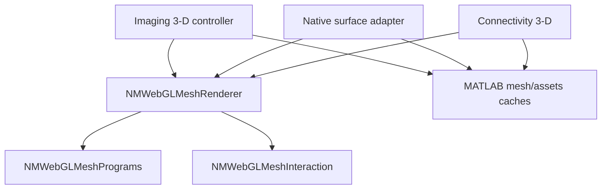

# Common mesh and 3-D rendering architecture

## Architectural scope

NM2 uses one browser mesh-rendering substrate for multiple scientific representations instead of maintaining separate WebGL engines for imaging surfaces, native cortical surfaces and connectivity 3-D scenes.

## Relationship

## Browser renderer authority

`ui/NMWebGLMeshRenderer.js` owns the shared scene/object renderer, camera/clip/lighting state application, offscreen rendering and common mesh object lifecycle. Shader/program specialization is separated into `ui/NMWebGLMeshPrograms.js`; interaction support is separated into `ui/NMWebGLMeshInteraction.js`.

Representation modules provide prepared geometry/scientific attributes and presentation settings. They should not fork renderer internals to implement representation-specific behaviour that can be expressed through the common scene/object contract.

## MATLAB materialization relationship

Geometry preparation and binary asset packaging occur through shared MATLAB services such as:

- `dataio/NMImagingMeshService.m`
- `dataio/NMImagingMeshAssetCache.m`
- `dataio/NMImagingRuntimeCache.m`

The browser consumes materialized geometry/assets; it does not recreate scientific spatial correspondence.

## Reuse across representations

The common renderer is used by:

- volumetric/surface-projection 3-D imaging via `NMResultsViewerImaging3DController.js`;
- native surface viewing via `NMResultsViewerSurfaceAdapter.js`;
- connectivity glass brain via `NMResultsViewerConnectivity3D.js`.

This shared substrate is also the basis for consistent capture/offscreen rendering, montage/video generation and Report Builder representation capture.

## Performance principle

Compile/program reuse, retained geometry and content-identity caching are architectural concerns because they span several representations. Exact cache keys, buffer mutation rules and rendering costs belong in the implementing renderer/cache functions.
