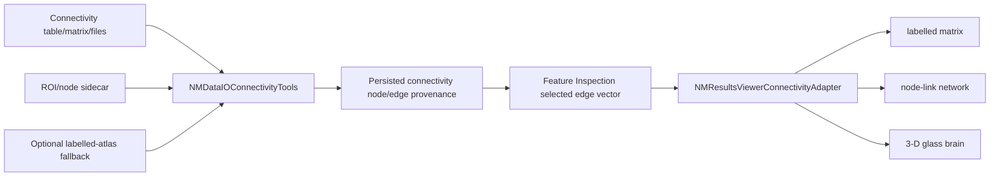

# Connectivity architecture

## Scope

Connectivity support is split between DataIO, which establishes node/edge identity and localization provenance, and Results Viewer adapters, which render already-resolved edge material as matrix, network or glass-brain representations.

## Flow

## DataIO authority

`dataio/NMDataIOConnectivityTools.m` normalizes connectivity inputs and establishes the canonical node/edge space. Sidecar row order is the node-order authority. Coordinates may come directly from the sidecar; a labelled atlas is a localization fallback when coordinates are unresolved. The atlas does not redefine node order.

Shared sidecar/atlas parsing is delegated to `dataio/NMDataIOAtlasDescriptorTools.m`.

Connectivity provenance is persisted with the modality descriptor and is the only downstream basis for interpreting the selected Feature Inspection vector as edges.

## Results Viewer adapter

`core/NMResultsViewerConnectivityAdapter.m` combines the authoritative selected measure/component vector with the persisted DataIO connectivity contract. It deliberately does not reopen sidecars or repeat DataIO correspondence decisions.

Browser representation authorities include:

- matrix: `ui/NMResultsViewerLabelledMatrix.js`;
- network: `ui/NMResultsViewerNodeLinkGraph.js`;
- glass brain: `ui/NMResultsViewerConnectivity3D.js`.

Shared structural anatomy and lighting controls are reused by the glass-brain representation.

## Scientific State

Connectivity matrix/network/glass-brain availability is advertised through the Scientific Capability/State layer. The browser admits the representations from that state rather than from filename or feature-count heuristics.

## QC

Connectivity QC remains a native connectivity visualization problem. DataIO QC uses the retained node/edge provenance rather than the generic tabular feature profile when connectivity provenance is present.
