# DataIO architecture

## Role

DataIO is the NeuroMiner authority that turns external/workspace data into training and OOCV/application modalities together with the case-axis, feature-space and spatial provenance required downstream. Browser and public-API configuration converge on the same MATLAB authorities; the browser does not define an independent scientific import grammar.

## Architectural rule

A provenance-specific layer may discover, retrieve and type-convert its source. Scientific semantics are generic wherever the problem is generic. In particular, DataIO must not maintain provenance-specific duplicates of:

- classification label canonicalization;
- Case-ID matching;
- row filtering;
- first-case-axis policy;
- Preview/QC/Commit materialisation;
- training/OOCV target semantics.

## Canonical flow

```mermaid
flowchart LR
    UI[Browser controls] --> STATE[NMDataIOStateTools]
    API[Public API specs] --> STATE
    STATE --> RETRIEVE[Provenance retrieval / inspection]
    RETRIEVE --> FILTER[Generic row filtering where applicable]
    FILTER --> ALIGN[Generic key / row-order alignment]
    ALIGN --> LABEL[Generic labels / covariates / class semantics]
    LABEL --> MAT[Canonical retained materialisation]
    MAT --> PREVIEW[Preview + diagnostics + mandatory QC]
    PREVIEW --> COMMIT[Commit]
    COMMIT --> NM[NM modality / OOCV container + datadescriptor provenance]
    NM --> RV[Scientific State / Results Viewer / Report Builder]
```

## Primary authorities

| Contract | Owner |
| --- | --- |
| Canonical source-type vocabulary and state ↔ IO translation | `dataio/NMDataIOStateTools.m` |
| Public import API | `dataio/NMDataIOAPITools.m` |
| Import target normalization | `dataio/NMDataIOImportTargetTools.m` |
| Generic matrix/tabular materialisation, Preview and Commit | `dataio/NMDataIOImportTools.m` |
| Label normalization and training class map | `dataio/NMDataIOLabelStatsTools.m` |
| Ephemeral retained materialisation | `dataio/NMDataIOMaterializationCache.m` |
| Structured diagnostics | `dataio/NMDataIOMessageTools.m` |
| Browser-mode/OOCV-container rules | `dataio/NMDataIOBrowserModeTools.m` |
| Database retrieval/type conversion | `dataio/NMDataIODatabaseTools.m` |
| Table reading and role references | `dataio/NMDataIOTableReadTools.m`, `NMDataIOTableRoleTools.m` |
| Volumetric/surface import | `dataio/NMDataIOImageImportTools.m`, `NMDataIOSurfaceTools.m` |
| Connectivity | `dataio/NMDataIOConnectivityTools.m` |
| ROI/parcellated data | `dataio/NMDataIOROIDirectTools.m`, `NMDataIOROIProvenanceTools.m` |
| Feature QC | `dataio/NMDataIOFeatureQCTools.m`, `NMDataIOQCReportTools.m` |
| Browser service/UI projection | `ui/NMDataIOUI.m`, `ui/NMDataIOUI_main.js` |

## Canonical provenance catalogue

`NMDataIOStateTools.sourceTypeCatalogue()` is the single provenance vocabulary for browser/API source identity. It owns the source id, user-facing label and provenance help file for:

- MATLAB workspace variables (`workspace`)
- MAT-file variables (`matfile`)
- MATLAB tables (`tablevar`)
- text/CSV/Excel files (`tablefile`)
- database connector (`database`)
- 3D image files (`image-list`)
- ROI-anchored connectivity (`connectivity`)
- surface/vertex scalar files (`surface-list`)
- ROI/parcellated data (`roi`)

Help/UI/documentation code must query this catalogue rather than maintaining another provenance list.

## State and persistence

`NMDataIOStateTools` translates browser/API state to the established IO representation and back. Persisted `input_settings`/DataIO state retain scientific source identity, roles, filters, alignment, label semantics and provenance needed for Modify/Resume. Transient execution resources are intentionally not persisted.

For database sources, credentials and live namespace/table catalogues are session-only. A restored database name does not imply that the current browser session has rediscovered the database. Resume/Modify therefore reconnects and rehydrates the live catalogue before source refresh.

## Case-axis contracts

Tabular/matrix DataIO supports three explicit alignment contracts:

1. **Shared key** — one ordered key tuple is applied to all participating row-bearing objects.
2. **Key per block** — each row-bearing label/feature/covariate block has its own ordered key tuple.
3. **Explicit row order** — participating objects are asserted to share row order and compatible row count.

When a new training/OOCV case axis is established, first-axis policy is explicit: complete-case intersection, target-anchored, or feature union. Later modalities align to the existing axis.

## Training-owned classification axis

Training labels establish the source-value → canonical-class mapping once. The persisted map is authoritative for labelled OOCV data. OOCV encounter order, class frequency or represented class subset never creates a new local class axis. Missing labels remain `NaN`; unseen raw OOCV classes are blocking.

## Filters

Generic tabular filters execute on provenance-object rows before key uniqueness, alignment and role materialisation. Object-specific rules target one source object; cross-table rules expand through the same object-level filter authority using exact shared column names. Filter columns do not need to be key or scientific-role columns.

## Preview, QC and Commit

Preview is read-only with respect to committed NM modality data. It invokes the canonical materializer, computes diagnostics and mandatory QC, and retains the materialisation in `NMDataIOMaterializationCache`. Commit reuses that retained materialisation when the scientific state is unchanged; otherwise it invokes the same materializer on cache miss.

The materialisation cache is execution state only. It is not serialized into NM, recipes, browser recovery state or generated API code.

## Provenance ownership downstream

Committed modality descriptors are the source of truth for feature-space/spatial provenance. Results Viewer and Scientific State consumers may adapt or project these contracts, but must not infer biomedical identity from feature names, vector lengths or generic visualization metadata.

Canonical ROI provenance preserves ROI IDs, names, ordering, hemisphere and spatial identity. Connectivity provenance preserves node/edge identity. Image/surface provenance preserves the native spatial reference required for QC and visualization.

## Browser navigation contract

Mandatory-field borders are a UI projection of existing readiness/validation rules, not a validator. The control owning the next mandatory action is red until satisfied and bright green after satisfaction. Candidate lists remain neutral when a separate Apply/Refresh action owns the requirement. Optional, hidden and disabled controls remain neutral.

Panel-level `?` buttons resolve stable help topics into one responsive in-page help drawer. The same drawer is used in ordinary browser and html-relay rendering because it lives inside the DataIO document. On wide viewports it docks at the right and the DataIO workspace shifts/contracts into the remaining width; on laptop-width viewports it overlays the right side without shrinking the import task. Clicking the same `?` again or the explicit Close button hides the drawer; another `?` reuses it and navigates to the requested anchor. Provenance help-file identity comes from the canonical source catalogue.

## Further documentation

See [`docs/dataio/README.md`](dataio/README.md) for lifecycle, API, diagnostics/QC and provenance-specific interactive help.
