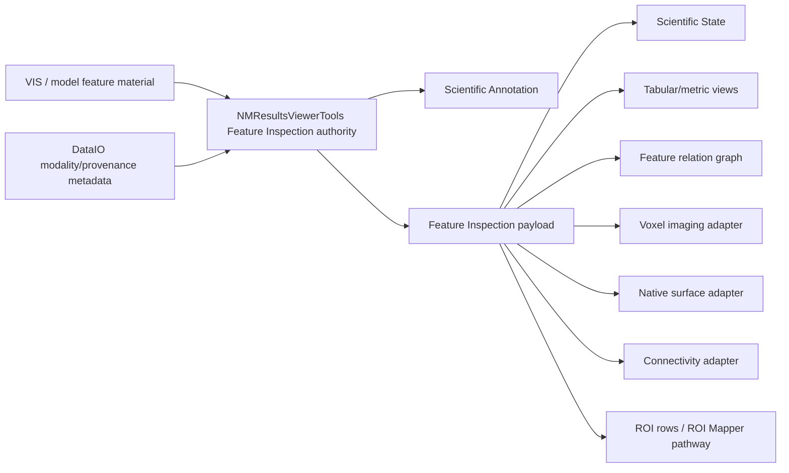

# Feature Inspection architecture

## Scientific role

Feature Inspection connects model-derived feature statistics with their original feature-space provenance. It must preserve the distinction between scientific selection (analysis, target, modality/context, retained component and measure) and presentation selection (table, graph, imaging, surface or connectivity representation).

## Cross-function flow

## Fusion and component semantics

Feature-space meaning is published through the Scientific Annotation rather than inferred by consumers from `visdata` position. The architecture distinguishes physical modality contexts from the combined fusion projection and keeps retained/back-projection component identity explicit. For early/intermediate fusion, the combined result namespace is projected onto one virtual modality: the first ordered member of the completed analysis `FUSION.M` contract. Scientific Annotation and Scientific State retain that virtual projection identity separately from the selected physical VIS member identities and feature counts. Thus a 704-feature combined early-fusion namespace and its 117-feature first physical member are distinct state coordinates. Physical member labels come from the exact analysis-local `visdata.params.features` axis; combined tabular labels are the ordered member axes, not the raw namespace of whichever physical member is currently selected.

The backend authority for these semantics is `core/NMResultsViewerTools.m`, with common vocabulary owned by `core/NMResultsViewerScientificAnnotation.m`.

## Feature relation graph

`core/NMResultsViewerFeatureGraphTools.m` owns construction of canonical feature-relation graph material from the bounded Feature Inspection relation input. Browser graph modules own presentation, filtering and interaction state. Report Builder consumes the same canonical relation material rather than defining an independent graph calculation.

Browser anchors include:

- `ui/NMResultsViewerFeatureRepresentations.js`
- `ui/NMResultsViewerFeatureGraphLabels.js`
- `ui/NMResultsViewerFeatureRibbon.js`
- `ui/NMResultsViewerGraphPresentationControls.js`

## Spatial representation routing

Spatial Feature Inspection does not use one generic plot for all feature spaces. Provenance determines the native family:

- voxel feature maps -> imaging viewer;
- native surface features -> surface viewer;
- connectivity edges -> connectivity representations;
- ROI fields with validated ROI provenance -> ROI-aware imaging/surface pathway and ROI Mapper;
- genuinely tabular features -> tabular/metric plots.

The Scientific State advertises which visualization families are available in the current payload context, and the browser admits representations from that state.

## Report Builder relationship

Report Builder discovers Feature Inspection components from the same Scientific State and authoritative Feature Inspection payload metadata. Browser-side report preparation reuses the representation adapters and retained presentation state rather than re-implementing Feature Inspection semantics.
