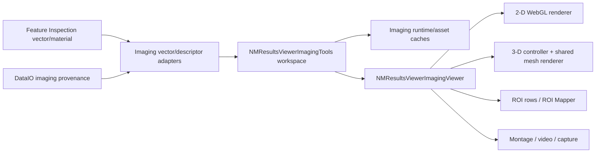

# Imaging architecture

## Scope

The imaging subsystem turns voxel-space scientific feature material into 2-D and 3-D representations while preserving one spatial-reference/display-semantics authority across interactive viewing, Report Builder, montage and video.

## Cross-layer flow

## MATLAB-side services

The principal backend authority is `core/NMResultsViewerImagingTools.m`. It combines Feature Inspection material with explicit imaging descriptor/vector adapters and shared services under `dataio/` for spatial reference, volume access, resampling, templates, atlases, meshes, slices, content identity and runtime caching.

Key adapter boundaries:

- `core/NMResultsViewerImagingDescriptorAdapter.m`
- `core/NMResultsViewerImagingVectorAdapter.m`
- `dataio/NMImagingSpatialReference.m`
- `dataio/NMImagingVolumeAccess.m`
- `dataio/NMImagingRuntimeCache.m`
- `dataio/NMImagingAssetCache.m`
- `dataio/NMImagingMeshAssetCache.m`

## Browser viewer

`ui/NMResultsViewerImagingViewer.js` is the browser presentation/state authority for imaging. It coordinates 2-D planes, 3-D volume/surface-projection representations, atlas/ROI presentation, view-state persistence, capture and report publication.

2-D rendering is delegated to `ui/NMImaging2DWebGLRenderer.js`. Three-dimensional scene control uses `ui/NMResultsViewerImaging3DController.js` over the common mesh renderer (`ui/NMWebGLMeshRenderer.js`).

## Display semantics

Display range, threshold and colour semantics are shared rather than independently re-derived by each renderer. Browser anchors include `ui/NMImagingDisplaySemantics.js`, `ui/NMResultsViewerDisplayControls.js`, and the shared colour/threshold modules. MATLAB-side display-semantic decisions are coordinated by `core/NMResultsViewerDisplaySemanticsTools.m` where backend planning requires the same scientific meaning. A scientific payload may register an explicit presentation domain when comparability requires a range wider than the currently displayed vector; the shared semantics authority then uses that declared domain for polarity, colour stops and full-range rendering rather than letting an individual renderer infer sign/range from only the current subject. The MLI viewspace uses this contract to keep its colour scale fixed across subject navigation.

## Retained resources and cold start

The architecture separates content identity from presentation state. Runtime caches and retained browser view resources allow 2-D/3-D switching and repeated captures to reuse materialized assets when scientific content is unchanged. Cold initialization remains distinct from steady-state representation switching.

A mounted Feature Inspection measure change uses the feature-only `results_viewer_alpha_imaging_feature_resource` boundary rather than rebuilding `results_viewer_alpha_imaging_workspace`. The browser supplies the exact resident context, grid/scaffold, structural/support, native-feature, atlas or surface-geometry identities established by the mounted workspace. The backend reuses the resident MATLAB materialization and transports only the changed feature arrays. It does not reselect or rewrite anatomy, atlas or surface geometry. A full workspace is requested only when those explicit resident identities are incompatible or their authoritative cached materialization is no longer resident.

Both 2-D and 3-D consume this same scientific-payload boundary. Adapter-specific code therefore updates presentation resources only after feature materialization has been resolved once; adapter selection does not choose a separate scientific feature-acquisition path.

For canonical volumetric ROI provenance, the feature-space cache additionally retains one exact atlas-label-to-canonical-ROI-column lookup materialization. That lookup and its support identity are invariant across measures. A retained ROI metric switch therefore resolves only the compact ROI vector and transports that vector with the invariant lookup; browser-side native sampling reconstructs the renderer field without a MATLAB display-grid materialization. Atlas membership discovery, generic voxel-feature reconstruction/alignment, support hashing, and full-volume content hashing are not repeated. The lookup is a visualization materialization of DataIO ROI identity and never becomes a competing ROI authority.

## Surface projection and volumetric rendering

The 3-D viewer can display both volumetric rendering and feature projection onto surfaces. These are representations of the same prepared scientific/spatial material, not separate scientific payload authorities. Shared mesh/program infrastructure is documented in [COMMON_MESH_RENDERING_ARCHITECTURE.md](COMMON_MESH_RENDERING_ARCHITECTURE.md).
