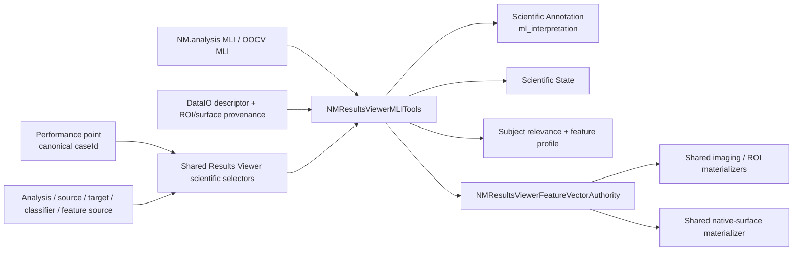

# Model interpretation visualization architecture

## Scope

Model interpretation (MLI) is a Results Viewer result type over persisted subject-by-feature relevance values produced by the NM 1.4/NM2 interpretation pipeline. The visualization port does not recompute interpretation scores. It resolves stored MLI material, publishes the same scientific feature-space coordinates used by Feature Inspection, and delegates spatial presentation to the existing shared Results Viewer adapters.

The only scientific-selection difference from Feature Inspection is deliberate: **MLI has no component coordinate**. Even when the predictive analysis used dimensionality reduction, persisted MLI relevance is defined in mapped/original feature space and is not selectable component-wise.

## Cross-function flow

## Scientific selection

MLI reuses the Feature Inspection coordinates for analysis, CV/OOCV source, target, classifier/model and feature source. Fusion behavior follows the same rules. In particular, early-fusion tabular analyses expose a synthetic **Combined feature view** only when every physical member is enabled and the shared feature-vector authority certifies every DataIO descriptor as tabular. Spatial, ROI and connectivity members are not concatenated into that synthetic context.

The subject is a local MLI row selector rather than a new model-result coordinate. The browser selector is keyed by the authoritative case ID, not by its zero-/one-based presentation position; the resolved source-row index is carried only as companion validation. Performance-point entry likewise carries the canonical point `caseId` only: the browser's point position remains a presentation/QC index, while `NMResultsViewerMLITools` uniquely resolves the subject ID against the authoritative CV/OOCV case list. Browser point order is never treated as an MLI source-row authority. Cached payload restoration also restores the backend-canonical payload context, so returning to a previously visited subject cannot leave a newer subject identity active in Results Viewer state.

## Stored relevance authority

`core/NMResultsViewerMLITools.m` is the sole Results Viewer authority over persisted MLI results:

- CV: `NM.analysis{a}.MLI`;
- OOCV/application: `NM.analysis{a}.OOCV{o}.MLI`;
- ordinary interpretation: `Y_mapped` plus persisted uncertainty fields;
- Shapley interpretation: `ShapleyValues`.

The configured interpretation method determines the relevance field. Uncertainty arrays are presentation metadata around ordinary MLI relevance and are not independent scientific payload choices.

## Spatial reuse boundary

`core/NMResultsViewerFeatureVectorAuthority.m` is the shared seam below Feature Inspection and MLI. Each result authority resolves its own scientific selection and exact feature vector; the existing imaging and surface adapters consume that vector without learning MLI storage semantics.

Consequently, MLI does not create temporary NIfTI files, rediscover atlases/annotations, or maintain a second voxel/surface renderer. Top-level Result-type availability is projected directly from persisted `analysis.MLI` / `analysis.OOCV{k}.MLI` metadata and does not materialize an MLI subject/context payload. The initial interactive MLI open serializes the compact O(S) subject catalogue once because the local subject selector requires it and performs one O(S × F) extrema scan of the selected persisted MLI context. That scan establishes **only the stable colour domain** across every subject and feature: positive-only contexts use `[0, max]`, negative-only contexts use `[min, 0]`, and mixed-sign contexts use a symmetric `[-max(abs), +max(abs)]` domain. Visibility thresholding is deliberately independent of that cross-subject scan. MLI declares the presentation policy `show_all_nonzero`: the global sign domain determines whether one or two threshold controls exist, but their initial cutoff lies immediately around zero (`±eps(0)` for signed data), excluding exact zeros only. Therefore neither global extrema nor subject-wise percentiles can empty a subject with subtler relevance values. User-edited thresholds remain presentation state across subject navigation and are not recomputed from a new subject. Only the two-number colour range and its exact scientific-context identity are retained; the complete matrix is never serialized or concatenated. Retained subject switches carry the authoritative case ID/index pair, omit catalogue serialization, reuse the display range in O(1), and include the canonical subject ID in feature-resource cache identity. They replace only the selected O(F) relevance row and reuse invariant anatomy, ROI provenance, surface geometry and renderer resources whenever their scientific identity is unchanged. Switching between already-mounted 2-D and 3-D representations is presentation-only.

## Tabular presentation

For non-spatial data, the browser renders one signed feature-relevance profile. Ordinary MLI retains the legacy `barMLI` uncertainty criterion `abs(Y_mapped_ciu) > abs(Y_mapped)` and its lower/upper error extents; Shapley values have no such uncertainty layer. A second panel lists the selected subject's original feature values when an exact matching CV row is resident.

The legacy binary-group percentile overlays are intentionally not copied into this initial NM2 path because they depend on base-workspace globals and repeated cohort-wide percentile computation. If restored, group references must come from an NM2 group authority and remain presentation material rather than a competing MLI payload.

## Current representation boundary

Voxel, canonical volumetric ROI, surface ROI and native surface MLI use the shared imaging/surface route. Connectivity-edge MLI is identified as connectivity material and is **not** silently rendered as tabular; browser wiring to the shared connectivity presentation controller remains a separate follow-up boundary.

## Subject ordering and model-score context

The Model Interpretability subject catalogue remains keyed to the authoritative CV/OOCV case IDs and original case indices. The browser may present that catalogue in original order or sort it ascending/descending by the active classifier/regressor score. This ordering is presentation state only: it is not a Scientific State coordinate and does not change MLI row identity.

Score metadata are projected once when the compact subject catalogue is built from the same Model Performance result authority used by the active analysis/source/target/classifier. Classification exposes the model score plus expected/predicted classes; regression exposes the prediction plus the observed target when available. Retained subject switches reuse the browser-resident catalogue and therefore do not recompute model scores or rematerialize MLI/spatial resources.
