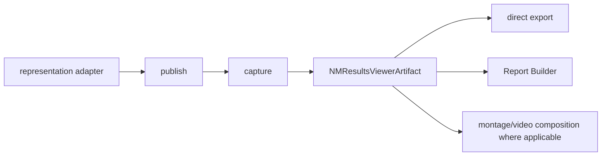

# Output, export and reproducibility architecture

## Unified viewer artifact boundary

Interactive representations publish and capture through `ui/NMResultsViewerOutput.js`. This produces a versioned viewer artifact abstraction for visual or tabular outputs, allowing export and Report Builder to consume representations independently of their renderer implementation.

## Direct export

Browser-side artifacts are passed through explicit Results Viewer output/export services implemented by `core/NMResultsViewerExportTools.m`, `core/NMResultsViewerTableExportTools.m` and the Results Viewer service handler. Scientific metadata/provenance travels with the artifact rather than being reconstructed from the DOM.

## Imaging/view state persistence

Imaging presentation state is normalized/serialized by `ui/NMImagingViewerState.js` and the imaging viewer. Saved state is presentation state; it does not replace current scientific payload/provenance validation when restored.

## Montage and video

3-D montage and video share the retained rendering/presentation state and common renderer rather than defining independent camera/display semantics.

Key anchors:

- `ui/NMResultsViewer3DMontage.js`
- `ui/NMResultsViewer3DVideoMaker.js`
- `core/NMResultsViewer3DVideoTools.m`

## Report Builder

Report Builder captures browser-native representations through the same artifact boundary and combines them with MATLAB/tabular report material. See [REPORT_BUILDER_ARCHITECTURE.md](REPORT_BUILDER_ARCHITECTURE.md).

## Code generation

DataIO and Report Builder expose code/script generation so an accepted interactive configuration can be represented as an editable MATLAB workflow. Code generation should serialize the canonical configuration/recipe, not derive scientific meaning from screen state.

Relevant anchors include:

- `dataio/NMDataIOCodeExportTools.m`
- `core/NMResultsViewerReportTools.m`
- `ui/NMResultsViewerUI.m`

## Reproducibility principle

Scientific selection/provenance and presentation state are distinct but both must be explicit in reproducible outputs. The scientific source remains the current NM/DataIO/Scientific-State authorities; saved presentation state controls how that scientific material is shown.

## Model-interpretation relevance-map export

Subject-level Model Interpretation (MLI) relevance maps are optional materializations of the persisted MLI result; they are not an input to MLI computation and are not a second scientific authority. `NM.analysis{a}.MLI` remains authoritative. The MLI method fixes the exported relevance quantity: `ShapleyValues` for Shapley analyses and `Y_mapped` for the other supported interpretation methods.

The NM2 MLI runner therefore completes and persists MLI first and only then invokes `NMMLIMapExportTools` when **Write subject relevance maps to disk** is enabled. The legacy writer inside `nk_MLInterpreter` is suppressed on the NM2 path. Direct legacy callers can still retain the historical voxel NIfTI side effect.

Export format follows DataIO provenance. Native voxel feature vectors are reconstructed in their authoritative feature-space mask and written as NIfTI. Native vertex vectors preserve vertex order exactly and may be written as GIFTI (`.func.gii`), MGH (`.mgh`), or MGZ (`.mgz`). The default surface mode follows persisted GIFTI/MGH/MGZ source containers and maps native FreeSurfer scalar sources to MGH; mixed surface formats require an explicit format selection. FreeSurfer MGH/MGZ output uses `save_mgh` directly and does not depend on `MRIread`/`MRIwrite`. ROI and tabular MLI vectors are deliberately not expanded into spatial files by this exporter.

Export failures are reported separately from the completed MLI computation. A missing format writer or unavailable file-backed voxel feature space therefore cannot invalidate an already persisted scientific MLI result.

