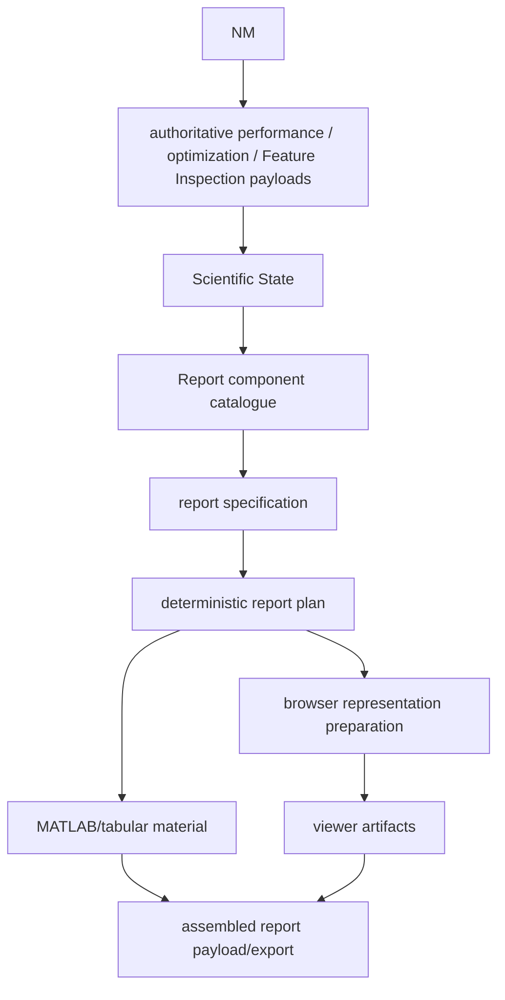
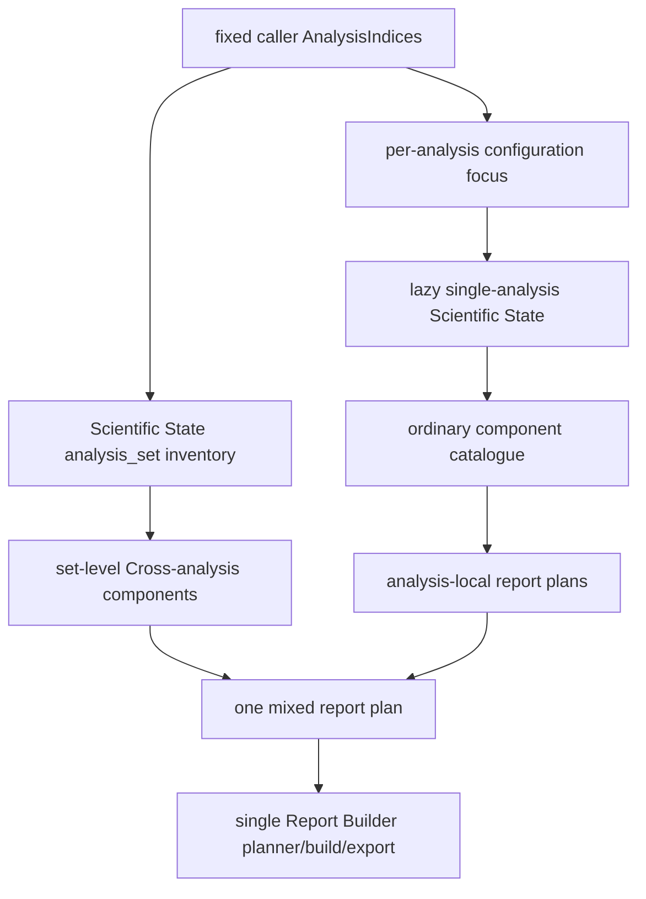

# Report Builder architecture

## Role

Report Builder is an API-first consumer of the same scientific authorities and browser representation adapters used by the interactive Results Viewer. It does not define an independent scientific-discovery or rendering stack.

## Current planning flow

Multi-analysis output ordering has two explicit report-composition projections. **By analysis** is the default and keeps each analysis's outputs contiguous so the existing report analysis headings delimit one section per analysis. **By component** groups the same component across analyses. Selecting either projection deliberately replaces manual row ordering; subsequent drag/arrow changes remain manual until the projection is selected again. Single-analysis Report Builder instances do not expose this control. Cross-analysis outputs remain a terminal block in every mode.

## MATLAB authority

`core/NMResultsViewerReportTools.m` owns report catalogue/planning and report payload assembly. The current catalogue is built from authoritative Results Viewer payloads plus `NMResultsViewerScientificState`; older documentation that described Scientific State as shadow-only is obsolete.

`ui/NMResultsViewerUI.m` exposes report catalogue, planning, building, script-generation and export operations through the restricted Results Viewer service boundary.

## Browser preparation

`ui/NMResultsViewerUI_main.js` prepares browser-native presentations when a report recipe requires them. It publishes the same representation adapters used interactively and captures them through `ui/NMResultsViewerOutput.js`.

This applies to imaging, connectivity and ROI Mapper presentations. Report Builder therefore inherits the accepted representation semantics and retained presentation state rather than reproducing them in report-specific renderers.

## Structural component and representation identity

Stable report component `Id` values are serialization/lookup identifiers only. Report Builder does not parse their prefixes or suffixes to reconstruct scientific type, feature metric identity, support domain, or renderer choice. Feature Inspection catalogue/planned components carry those semantics in `Instance`, including `ComponentType`, `MetricId`/`YMetricId`, `SupportDomain`, `RepresentationId`, `PresentationMode`, and `PresentationArtifactRequired` where applicable.

`AnalysisPlans[].FeaturePresentations` carries the requested `Representation` together with its structural `SupportDomain`, view mode, canonical views, and montage state. The shared `NMResultsViewerFeatureRepresentations` authority defines representation support/adapters; Report Builder binds the authoritative support domain once from the retained scientific context/representation authority and then consumes `Instance.SupportDomain`. There is no Report-Builder-local support-domain resolver.

A spatial/connectivity representation is therefore a structural execution requirement: browser preparation writes `RepresentationId`, `SupportDomain`, `PresentationMode`, and `PresentationArtifactRequired=true` into the planned component before MATLAB materialization. Removing or tampering with the required visual artifact fails explicitly. The tabular bar is itself an explicit registered representation (`feature.metric_bar`, support domain `tabular`, presentation mode `bar`) and is rendered only when that representation is selected; absence of presentation metadata never means “use a bar”. Unknown component viewspaces/types/ids fail explicitly rather than falling through to another renderer.

## ROI Mapper relationship

ROI Mapper admission is established once while configuring the Report Builder virtual viewspace. The State-gated Feature Inspection catalogue supplies canonical context/provenance identity; the shared `NMResultsViewerFeatureRepresentations` registry supplies ROI-Mapper linkability; canonical ROI-provenance sidecars or the retained/saved atlas/annotation state supply resource readiness. The resulting exact Feature Inspection context ids and the selected comparison coordinate are serialized in `PresentationState.RoiMapper`.

Preview and export do **not** re-establish ROI Mapper availability, support domain or admissible comparison coordinates. They resolve only those configuration-approved context ids to the planned Feature Inspection payloads, pass the already-selected comparison coordinate to the shared ROI comparison grouping planner, and materialize the ROI publication through the existing imaging/ROI authority. Execution may reject a missing referenced context or a grouping/materialization invariant, but it cannot substitute another context/comparison coordinate or call `availableKinds(...)` as a second admission gate. ROI-provenance contexts with canonical volume/surface sidecars are ROI-ready by design and therefore do not require an additional atlas gate in Preview/export.

The earlier deferred-materialization split in which metadata admitted ROI Mapper during configuration while a separate Scientific-State comparison gate re-decided availability during Preview/export is retired. Configuration remains metadata/resource-state only and does not perform atlas projection or feature-scale materialization; the expensive work is still deferred until the configured ROI output is actually prepared. Compatible ROI signatures are grouped for one ROI Mapper presentation; the Mapper remains presentation-only.

## State source and reproducibility

Report recipes distinguish scientific context from presentation state. A recipe can use retained/saved viewer presentation where appropriate while scientific component admission remains determined by current authoritative payloads/Scientific State.

Interactive Report Builder recipes preserve the canonical Feature Inspection identities supplied by the component catalogue. `PayloadSpec.featureContextId` and any retained-component identity are not stripped and reconstructed from modality indices. The browser serializes the selected authoritative context ids directly in `AnalysisPlans[].FeatureInspectionPlan`; `AnalysisPlans[].FeatureSelection` natural-selector compilation is reserved for explicit API recipes that intentionally use that public abstraction. Backend planning may validate/materialize the explicitly named context, but it does not choose a replacement context for an interactive report. Representation/presentation state therefore binds to the same scientific context that the user configured. For spatial/comparative report output, routing also consumes the `supportDomain` stored with that same authoritative context state; a replanned `FeatureKind` is validation metadata and cannot independently redirect the report to a tabular representation. If the context-state binding is absent, report generation fails instead of falling through to a feature-metric bar.

## Export/code generation

Report Builder can assemble/export report artifacts and generate editable MATLAB recipe scripts through the same backend authority. Script generation is a reproducibility interface, not a second report-planning implementation.

## Multi-analysis composition

Report Builder distinguishes scientific inventory from report-plan state. A caller may invoke the same Report Builder implementation with a fixed `multi_analysis` context containing an explicit set of analysis indices. The backend constructs `NMResultsViewerScientificState.forAnalysisSet` for that set and uses it to admit set-level Cross-analysis components, including the Performance Table, the CV-compatible Statistical Comparison, and the descriptive aggregate-performance Visual Comparison. Ordinary component catalogues remain lazily loaded for the currently configured analysis through the same single-analysis Scientific State path used elsewhere.

Report specifications use one canonical per-analysis schema: `AnalysisPlans`. A single-analysis report has exactly one `AnalysisPlans` entry; a multi-analysis report has one entry per analysis. `FeatureSelection`, `FeatureInspectionPlan`, `FeaturePresentations`, analysis-local `PresentationState`, and `DisplayOverrides` exist only inside those entries. Root `PresentationState` is report-global and carries only `OutputOrder`. Normalization rejects the obsolete root analysis-local fields explicitly; there is no compatibility alias or second schema representation. Planned classifier-scoped components carry stable `Instance.Id` identities, so applying normalization and planning again preserves component identities, count, and order without a separate expansion flag or repeated feature-selector materialization. Component selection is report-global within the fixed analysis set: every selected component is requested for every analysis. On startup, the ordering list is populated directly from the resident component selection; this compact browser projection performs no backend planning. Analysis-local catalogues and coordinates are resolved lazily only after the user changes the report selection or initiates a build/script/export action; Report Builder performs no analysis-wide export planning during startup. The analysis dropdown remains a configuration focus only and does not change the fixed scientific scope. An explicit “Apply configuration to all analyses” action propagates only coordinate-dependent feature/presentation settings. Presentation propagation is semantic rather than a raw state copy: each target keeps its own authoritative feature context/support domain, exact canonical representation ids shared with the template are copied only when the target catalogue admits them, and Montage settings are re-seeded/normalized through the target analysis's existing Results Viewer presentation authority. Context-specific saved viewer-state files and unsupported representation ids are not transplanted or aliased. The applicability summary is routed through the general Results Viewer message strip. Catalogue construction already materializes compact Feature Inspection metadata for the focused analysis; that same payload is returned to the browser in both ordinary and multi-analysis scope so an imaging context can enter the shared `NMResultsViewerImagingViewer.defaultState/normalizeState` presentation lifecycle at Report Builder activation or focus change. Existing retained context state is preserved. Montage controls and report capture remain strict consumers of this resident state and do not synthesize fallback presentation state. Caller-owned set-level Cross-analysis request coordinates are retained separately from the active analysis-local request and are reapplied only to Cross-analysis component payload specifications after a focus refresh, so target/model-source/classifier/reference coordinates cannot be overwritten by ordinary workspace selectors. Statistical and Visual comparison retain distinct target/model-source/classifier request fields so configuring one set-level component cannot silently overwrite the other. The queried `analysis_set` Scientific State is retained at the Results Viewer session boundary and supplied back to catalogue construction for every focus switch, so unchanged analysis-set capability/CV inventory is not rebuilt. During planning, `NMResultsViewerReportTools` groups ordinary component specifications by their explicit `PayloadSpec.analysisIndex`, applies the established single-analysis planner separately to each group, then appends set-level Cross-analysis components by default. Browser-side representation preparation resolves `FeaturePresentations`, retained/saved presentation state, display overrides and ROI Mapper state from the matching `AnalysisPlans` entry by that same explicit analysis index; there is no second top-level analysis-local encoding. Consequently the same imaging/connectivity publication path is used in ordinary and multi-analysis reports, and a requested spatial representation cannot silently fall through to the generic feature-metric bar component. Statistical report tables and plots are projections of the same `cross_analysis.statistical_comparison` artefact authority used by the workspace; Report Builder contains no independent Wilcoxon, Quade, FDR, pairwise-delta or confidence-interval implementation. Visual report tables and grouped-bar/line SVG are projections of the same `cross_analysis.visual_comparison` aggregate Model Performance artefact; Report Builder does not reopen `prob_contigency`, derive performance metrics, impose CV equivalence or run inference for that component. No duplicate Report Builder implementation exists for Cross-analysis.

When invoked from the Cross-analysis toolbar, the fixed set is inherited from the caller and no analysis-set selector is shown inside Report Builder. The direct toolbar action remains visible; Cross-analysis exposes no separate Report Builder tab or implementation. Report-plan choices (selection, ordering, layout, export format) are not stored in Scientific State.

The fixed analysis set is a composition scope, not a global compatibility assertion. The ordering list and exported recipe are projections of the user's global component selection plus explicitly selected set-level Cross-analysis components. Each selected component is retained for every selected analysis even when that analysis has a different target, CV structure, modality combination, or non-overlapping payload inventory. If the local catalogue does not expose the requested component, the report contains an explicit unavailable notice with the catalogue reason; this is a report result, not a planning error. An explicit empty `Components` array remains empty and is never expanded to catalogue defaults. “Apply configuration to all analyses” is separate: it queries shared coordinates and copies only the admissible subset of coordinate-dependent presentation settings. Cross-analysis artefacts apply only their own scientific admission contracts. Report Builder Visual Comparison declares `per_analysis_default` context mode and resolves each analysis through the established Model Performance selector authorities; heterogeneous target, model-source, model-result and fusion coordinates are recorded in `analysisContexts`, while analyses without an available default Performance payload are recorded in `excludedAnalyses`. The interactive Visual Comparator keeps its explicit shared-coordinate contract.

Direct CSV/TSV/XLSX export from the Performance Tabulator bypasses Report Builder but still uses the existing generic Results Viewer table-output serializer. This is a table-export shortcut, not a second scientific or spreadsheet-export authority.
