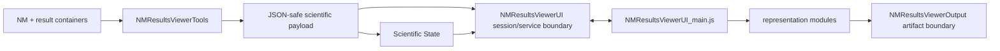

# Results Viewer architecture

## Overview

The NM2 Results Viewer is a read-only browser client backed by MATLAB scientific authorities. `ui/NMResultsViewerUI.m` establishes a session, exports initial state and assets, and dispatches restricted service operations. `ui/NMResultsViewerUI_main.js` owns the interactive browser state and coordinates representation modules.

## Backend payload authority

`core/NMResultsViewerTools.m` is the principal backend extraction authority for performance, actions, optimization, Feature Inspection and related payloads. It preserves legacy scientific semantics where required by delegating to established transformation paths rather than having the browser inspect result structures directly.

Additional domain adapters extend the same boundary for imaging, native surface and connectivity representations:

- `core/NMResultsViewerImagingTools.m`
- `core/NMResultsViewerSurfaceTools.m`
- `core/NMResultsViewerConnectivityAdapter.m`

## Cross-analysis workspace and shared analysis-set inventory

The existing top-level `comparison` result type is the Results Viewer entry point for operations spanning more than one completed analysis. A reusable Analysis Set selector presents completed analysis IDs/descriptions, Select all/Deselect all controls, an explicit **Query results** action and a capability overview. The overview is produced by Scientific State `analysis_set` inventory mode: Model performance, Model optimization, Feature inspection and Interpretation capability flags come from the same `NMResultsViewerTools.resultTypesForAnalysis` authority used by the ordinary Result type selector, optimization-criterion identity comes from `NMResultsViewerTools.modelOptimizationCriterionIdentity`, and CV-equivalence groups come only from `nk_GetAnalysisStatus`. The browser does not infer capability, criterion identity or CV compatibility.

The Cross-analysis workspace exposes four operation slots: Performance table, Statistical comparison, Visual comparison, and Multi-analysis Results Builder. Performance, Statistical and Visual comparison consume the same queried analysis-set inventory. Selection changes make the inventory stale until the user explicitly queries again. Once queried, the server-side Scientific State inventory is retained by Results Viewer session plus canonical analysis-set identity; consumers reuse that exact state until the set or persisted session NM changes.

`core/NMResultsViewerCrossAnalysisTools.m` materializes the Performance table and descriptive Visual comparison from existing Model Performance authorities, and the Statistical comparison from the existing Model Optimization CV2-partition materialization; it does not reopen analysis result containers to rediscover scientific identity. Statistical admission requires one exact optimization-criterion key and one `nk_GetAnalysisStatus`-derived CV group across the set before any full Model Optimization payload is requested. Statistical dispatch is fixed: two analyses use paired Wilcoxon, more than two use Quade unless exactly one reference analysis is selected, in which case paired reference-vs-other Wilcoxon is used. One persistent Cross-analysis presentation tool owns aliases and original/ascending/descending ordering for all operations. The statistical presentation provides criterion-scaled performance views, backend-supplied KDE violins, box or median/IQR alternatives, and a same-width FDR heatmap. KDE is generated once by `NMResultsViewerTools.violinDensity`; both OOCV and Cross-analysis render it through the single `NMResultsPlotD3.violinPolygon`/`violinStatisticLines` primitive. `NMResultsViewerTools.modelOptimizationRandomReference` is the sole authority for optional classification random-performance lines and derives them from canonical criterion identity plus classifier class count; regression and undefined/prevalence-dependent references are omitted. Shared `NMResultsPlotD3` text fitting keeps short aliases horizontal and abbreviates only overflowing labels. The heatmap defaults to the legacy spectrum, treats values below `-log10(0.05) ≈ 1.3` as white, and exposes presentation-only colormap/value-label controls. Every plot or table panel delegates all supported formats to one generic Results Viewer export control/dialog.

The descriptive Visual comparison is deliberately different: classification projects the legacy 17 aggregate measures from `performanceTabulationRows`, while regression preserves the metric identities exposed by those same authoritative Model Performance rows. Both use the discovery/CV out-of-training source, apply no CV-equivalence restriction and run no inference. Binary and multi-class class-vs-REST visual contexts must share the same canonical target, class-contrast, model-result/model-source and fusion coordinates from Scientific Annotation; regression remains descriptive and does not invent a second metric catalogue. Visual sorting, grouped-bar/line presentation, right-axis assignment, aliases and colours are presentation state only.

The Performance Tabulator has two distinct output paths. **Export CSV/XLSX** publishes the already-materialized numeric table through the shared `NMResultsViewerOutput`/table-export authority and does not invoke Report Builder. **Report builder** passes the caller's current queried analysis set as a fixed `multi_analysis` invocation context to the single flexible Report Builder implementation. The Report Builder does not expose a second analysis-set query selector in this caller-fixed mode; it may use a per-analysis focus selector solely to configure ordinary components within that fixed set.

## Browser state authority

The main browser controller owns active selection and presentation state. Scientific availability comes from the backend Scientific State, while visual controls remain presentation state and must not become alternative scientific-selection authorities.

The browser maintains separate identities for scientific content and presentation/view state so expensive scientific payloads can be reused when only display controls change.

## Representation modules

Major representation authorities include:

- imaging: `ui/NMResultsViewerImagingViewer.js`
- surface: `ui/NMResultsViewerSurfaceAdapter.js`
- connectivity matrix/network/glass brain: `ui/NMResultsViewerLabelledMatrix.js`, `ui/NMResultsViewerNodeLinkGraph.js`, `ui/NMResultsViewerConnectivity3D.js`
- feature relations: `ui/NMResultsViewerFeatureRepresentations.js` and associated graph modules
- model optimization: `ui/NMResultsViewerModelOptimization.js`

These modules consume prepared payloads and own representation-specific state; they do not reopen `NM` or DataIO source files.

## Shared controls and presentation infrastructure

Shared browser control families are separated from scientific extraction:

- `ui/NMResultsViewerControlHost.js`
- `ui/NMResultsViewerDisplayControls.js`
- `ui/NMResultsViewerViewControls.js`
- `ui/NMResultsViewerInformationControls.js`
- `ui/NMResultsViewerPanelControls.js`

The generic Results Viewer message/info strip is the user-facing status channel. Representation modules should route user-visible informational, warning and error content through that shared mechanism rather than create competing local status authorities.

## Output boundary

Representations publish/capture through `ui/NMResultsViewerOutput.js`. This gives exports and Report Builder a common artifact boundary independent of how a representation was rendered.
