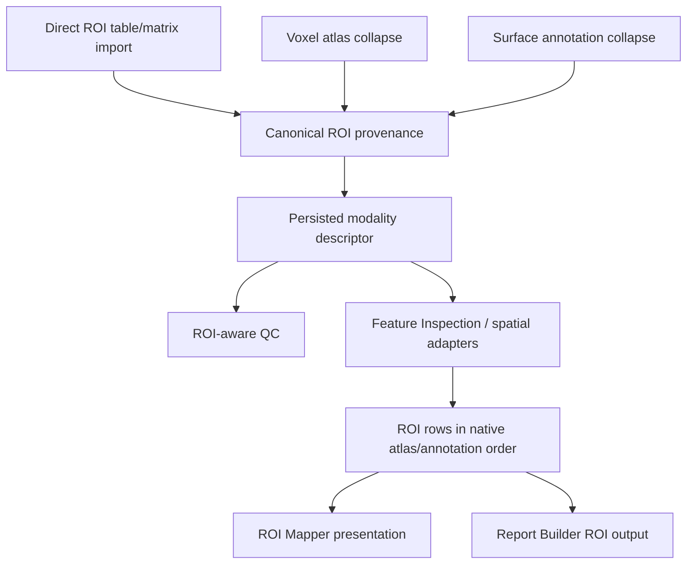

# ROI and atlas architecture

## Canonical ROI identity

ROI-valued feature matrices may originate from several producer pathways, but downstream code consumes one canonical ROI provenance boundary owned by `dataio/NMDataIOROIProvenanceTools.m`.

The canonical contract preserves data-column-to-ROI identity and explicit spatial references. ROI semantics are therefore declared, not guessed from vector size, feature names or generic modality labels.

## Volumetric atlas relationship

Volumetric ROI provenance refers to a labelled atlas as the spatial reference. Shared atlas descriptor parsing and atlas-derived ROI coordinate/label services are owned by `dataio/NMDataIOAtlasDescriptorTools.m`. DataIO establishes the provenance; Results Viewer imaging services consume it.

For interactive imaging, the exact atlas-label→canonical-ROI-column relationship may be materialized once as a compact resident voxel lookup keyed by the authoritative feature-space identity. Repeated feature payloads reuse that lookup and the already-established support identity. This is a performance materialization only: canonical ROI IDs/order and the labelled atlas remain the scientific authority, and the lookup is invalidated rather than repaired if those identities differ.

## Surface annotation relationship

Surface ROI provenance refers to hemisphere-specific annotation sources plus surface geometry provenance. DataIO validates and persists the correspondence; the Results Viewer surface pathway paints ROI values onto the native surface using the retained annotation identity rather than displaying them as generic tabular data.

## Direct ROI import

`dataio/NMDataIOROIDirectTools.m` supports ROI matrices whose spatial provenance is supplied directly rather than created by voxel/surface collapse. It converges into the same canonical ROI contract so OOCV alignment, QC and Results Viewer consumption use one ROI identity model.

## ROI QC

`dataio/NMDataIOFeatureQCTools.m` prepares resident ROI QC reference material from canonical provenance. Volumetric ROI QC uses the labelled atlas; surface ROI QC uses annotation/geometry provenance. The browser should not rematerialize the atlas/annotation for every subject switch.

## ROI Mapper

`ui/NMResultsViewerROIMapper.js` is presentation-only. It receives already-computed ROI rows, atlas/annotation identity and parent display thresholds from the imaging/surface authority. `ui/NMResultsViewerImagingViewer.js` is the principal publication bridge from Feature Inspection into the Mapper. Report Builder uses the same publication path.

ROI Mapper comparisons therefore do not become a second ROI materialization authority.
