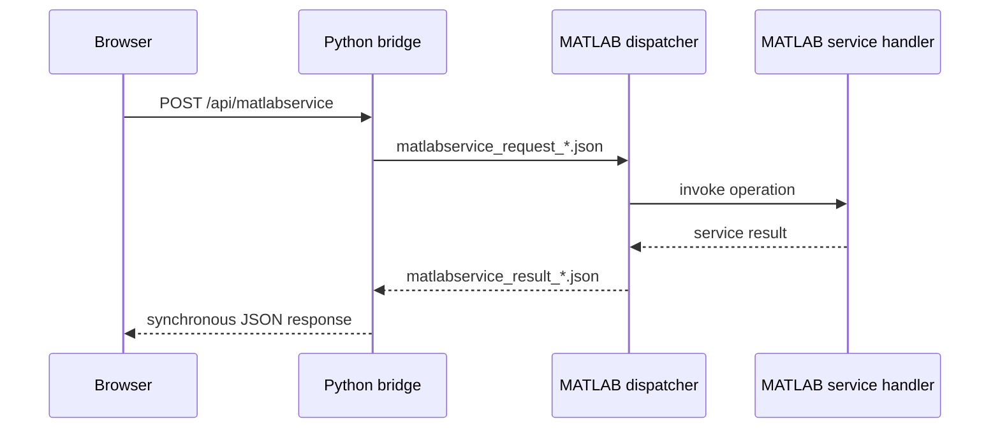
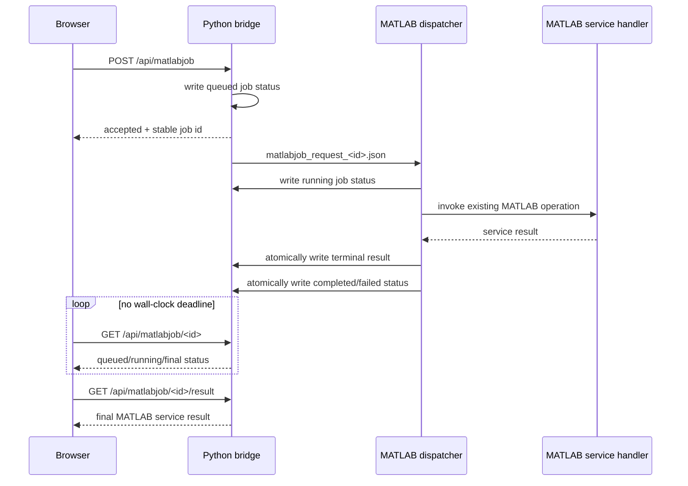

# Runtime bridge and lifecycle architecture

## Architectural scope

NM2 browser UIs run against a local HTTP bridge that exposes a narrow set of session/file/service operations. The bridge is transport infrastructure; scientific interpretation remains in MATLAB authorities.

Two MATLAB execution contracts coexist deliberately:

- **Synchronous `matlabservice`** for short, bounded service operations. These requests retain finite transport timeouts so a genuinely stalled ordinary request remains diagnosable.
- **Durable `matlabjob`** for legitimate long-running MATLAB computations. A job has no wall-clock execution timeout. HTTP submission is acknowledged immediately and the browser subsequently observes file-backed job status/result state.

A long-running operation must use the durable-job contract rather than increasing the synchronous timeout.

## Lifecycle

### Ordinary synchronous service



### Durable runtime job



The MATLAB dispatcher still executes a durable job synchronously on MATLAB's owning thread. The architectural change is that **transport lifetime is detached from computation lifetime**: no HTTP request waits for the computation to finish.

## Application startup versus browser replacement

Only `nm.m` supplies `applicationStartup=true` to `NMAppUI.openWorkbench`.
That entry point discovers abandoned isolated sessions and asks whether to
adopt one before launching the bridge. Ordinary workbench calls omit the
argument and do not discover abandoned sessions; shared-session contexts
also exclude discovery. `NMAppUI.open` receives the selected session context
and initial query and performs no recovery discovery.

Workbench child preparation and return export/import within the current
session. Configurator CV and synthetic-label editors are inline views of the
Configurator page. Neither route re-enters application startup. A lost browser
while MATLAB remains alive is handled separately by `nm_open_ui`, which
replaces the controller within the same bridge run. This does not scan for
abandoned sessions or adopt another session directory.

The Python bridge owns live controller metadata in `CLIENT` under `CLIENT_LOCK`.
Its authenticated `/api/diag` response exposes a snapshot of that existing state.
MATLAB consumes this snapshot in the existing one-second bridge health poll;
a failed health request follows the existing bridge-unreachable path and does
not reuse an older controller snapshot. No `client_state.json` liveness copy
is written or read. Draft persistence in `nm2_state.json` remains separate.

## Core transport anchors

- `bridge/nm_open_ui.m`
- `bridge/nm_ui_bridge_dispatch_requests.m`
- `bridge/nm_ui_bridge_python_template.m`
- `bridge/nm_ui_bridge_cleanup_requests.m`
- `ui/NMUIBridgeTools.m`
- `ui/NMRuntimeJobClient.js`
- `core/NMRuntimeProgressTools.m`

The Python server is generated from the MATLAB template and serves scoped session state/assets plus restricted API routes. MATLAB-side dispatch resolves both synchronous `matlabService` requests and durable job requests against the same active UI handler; the job channel therefore does not duplicate operation logic.

## Job state authority

For one bridge session, the durable job state files are:

```text
matlabjob_status_<jobId>.json
matlabjob_result_<jobId>.json
```

Status is compact and follows:

```text
queued -> running -> completed
                  \-> failed
```

Terminal status advertises `resultAvailable=true` only after the result file has been atomically committed. The result retains the same MATLAB service response contract the operation would have returned synchronously.

The job id is browser-generated or bridge-generated, session-local and stable. Browser clients may persist it in `localStorage` to reattach after a page reload. Status/result files are removed at bridge-session boundaries, not during an active session.

## MATLAB ownership while a job runs

MATLAB is single-owner for these legacy/runtime operations. While a durable job is queued or running, the Python bridge **does not queue unrelated synchronous MATLAB-backed requests**. Such requests receive an immediate busy response naming the active job instead of waiting until their ordinary service timeout expires.

Direct Python/file side channels remain available while MATLAB is busy, including:

- runtime progress polling;
- durable job status/result polling;
- current-config file writes;
- kill-state polling;
- static UI assets.

This separation prevents benign multi-hour/day computations from producing misleading `matlabservice request timed out waiting for MATLAB-side handler` messages.

## Progress and interruption

Long operations continue to publish progress through `NMRuntimeProgressTools` and `/api/progress/<taskId>`. Progress is advisory and independent from job completion authority: job completion comes only from terminal durable-job status.

Ctrl+C/interruption handling remains part of the MATLAB/session lifecycle. A caught MATLAB operation failure is published as failed job state. A process-level interruption can leave the last job status at `running`; the existing bridge kill-state path remains the authoritative indication that the MATLAB session itself was interrupted.

## Session isolation and rehydration

Run identifiers prevent a bridge from exposing job state created by another bridge session. Browser reload within the same live bridge can reattach using the persisted job id and progress task id without issuing a MATLAB service request while MATLAB is busy.

Closing or reloading the browser tab does not cancel the MATLAB computation because no initiating HTTP request remains open. The normal `Finish / close` bridge-session action is rejected while a durable job is queued/running; otherwise session cleanup would destroy the reattachment/status channel before MATLAB returns. Explicit MATLAB interruption remains the cancellation path. Normal session persistence occurs when the MATLAB operation returns and the bridge lifecycle resumes.

## Recovery-compatible UI control contract

Browser draft recovery is defined over a small shared control contract rather than page-specific field names. Recovery-managed configuration pages use native `input`, `select`, `textarea` or `contenteditable` controls with a stable `id` or `name`; an explicitly registered `data-nm-recovery-key` is reserved for a genuinely new control whose identity cannot be expressed by the existing contract. DOM position is not a recovery identity because layout changes would silently retarget saved values.

Before adding an editable control to an NM2 UI, the existing recovery-control library/contract must be used first. If the required interaction can be represented by an existing supported control, the UI must use that control and stable identity. If genuinely new control semantics are required, the shared recovery-control library must be extended and validated before that control is introduced into an application page. Page-specific recovery exceptions are not permitted.

The Stage 0A architecture test audits all current recovery-managed configuration editors and runtime-runner UIs for this contract. A new unidentified editable control is therefore a test failure rather than a silently non-recoverable setting.

## Performance boundary

Durable-job polling transfers compact status JSON only. The final potentially larger operation result is transferred once, after completion. Progress polling remains on its existing compact file-backed channel. The durable-job architecture must not repeatedly serialize scientific result state while a job is running.

## Runner contract

All NM2 runtime execution actions use the durable job channel, irrespective of their expected duration:

- `preprocess_runner_run`
- `ml_train_runner_run`
- `vis_runner_run`
- `model_export_runner_run`
- `mli_runner_run`

This is a lifecycle contract rather than a duration heuristic. A run that is usually short may legitimately become long for a different dataset, model family, CV grid or machine. Browser reload reattaches to the same session-local job identity before any synchronous refresh is attempted. Script generation, configuration refresh, selectors, metadata inspection and other bounded runner services remain synchronous and timeout-protected.

## Migration rule

Any additional NM2 operation that can legitimately run for an unbounded user-dependent duration (hours or days) should be submitted through `matlabjob`. A finite timeout on such an operation is not a substitute. Short metadata, selection, inspection and configuration services remain synchronous and timeout-protected.
