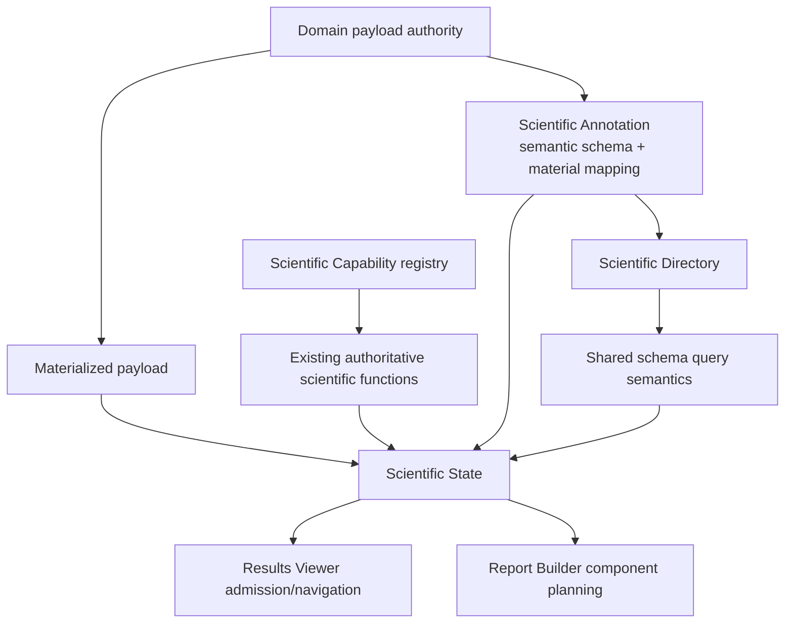

# Scientific semantics and runtime state architecture

## Why this layer exists

Results Viewer consumers need a common scientific vocabulary without becoming coupled to the storage grammar of individual `NM` result containers. NM2 separates four related but distinct authorities: Scientific Annotation, Scientific Capability, Scientific Directory, and runtime Scientific State.

## Current authority graph

## Scientific Annotation

`core/NMResultsViewerScientificAnnotation.m` defines the shared cross-domain scientific vocabulary and the mapping between semantic schema and domain materialization facts. The current implementation identifies itself as `NM-SCIENTIFIC-ANNOTATION-V7` and includes the `ml_interpretation` domain, which shares Feature Inspection coordinates except that its component coordinate is not applicable.

The annotation is attached by domain authorities after they have resolved the underlying scientific material. It is not a substitute materializer and does not own raw `NM` traversal.

For multi-class Model Performance, the target schema also carries the scientific class contrast. Aggregate multi-group performance is represented as `schema.target.classContrast = all_classes`; a selected class-vs-REST artefact is represented as `one_vs_rest` together with its canonical `classIndex` and `className`. This identity is produced by the Model Performance materializer and is therefore available to Scientific State, Scientific Directory, Cross-analysis and Report Builder without downstream interpretation of `multiClassModeIndex`.

## Scientific Capability

`core/NMResultsViewerScientificCapability.m` registers existing authoritative scientific functions and interrogates their semantic needs/provides declarations. The registry therefore identifies which authorities can participate in capability discovery without centralising their scientific implementation. The current registry contract is `NM-SCIENTIFIC-CAPABILITY-V2`.

Registered authorities include performance/result extraction, QC, model optimization, Feature Inspection/relation payloads, ML interpretation, imaging, native surface and connectivity pathways.

## Scientific Directory

`core/NMResultsViewerScientificDirectory.m` is a lightweight index/query authority over already-valid scientific annotations. It indexes scientific schema plus opaque caller-owned references. It does not own numerical payloads or materialize them. Its current contract is `NM-SCIENTIFIC-DIRECTORY-V1`.

The Directory also supplies the common schema matching semantics reused by Scientific State queries.

## Runtime Scientific State

`core/NMResultsViewerScientificState.m` builds a runtime scientific-space view from already materialized payloads and the registered capability graph. It distinguishes materialized scientific artefacts from derivable artefacts and visualizations while retaining source identities and schemas rather than copying numerical arrays. Its current contract is `NM-SCIENTIFIC-STATE-V1`.

The current Results Viewer and Report Builder consume this state directly. This supersedes older documentation that described Scientific State as shadow-only or Report Builder discovery as independently authoritative.

Report Builder may retain compact configuration facts derived from the State-gated catalogue, such as the exact Feature Inspection context ids admitted for ROI Mapper and the user-selected comparison coordinate. Those facts are references into authoritative Scientific State/catalogue identity, not a second scientific-state materialization. Preview/export consume those established references and do not rediscover ROI Mapper availability or comparison coordinates from newly materialized payloads. Heavy atlas/ROI resources remain outside Scientific State and are materialized only by the existing imaging/ROI authority when output is prepared.

The V7 source schema also makes result/application source, model source, and OOCV subgroup index explicit (`schema.source.id`, `schema.source.modelSource`, `schema.source.subgroupIndex`). These coordinates were previously present only in material/runtime identity and are now queryable through Scientific Directory/State.

### Explicit analysis-set inventory mode

Scientific State retains its lazy single-analysis behavior for ordinary Results Viewer interaction, but it can also be explicitly requested for a fixed set of completed analyses through `NMResultsViewerScientificState.forAnalysisSet`. This `analysis_set` mode is an inventory operation, not eager multi-analysis result materialization.

The inventory reuses the same `NMResultsViewerTools.resultTypesForAnalysis` capability authority that populates the ordinary Result type selector for each member analysis. Each inventory row stores both that compact result-type catalogue and `effectivePerformanceResultType`, resolved once through `NMResultsViewerTools.defaultPerformanceResultType` from the already-built catalogue. It also stores the fixed-schema Model Optimization criterion identity (`key`, code, labels and display scale) from `NMResultsViewerTools.modelOptimizationCriterionIdentity`. Cross-analysis can therefore reject criterion-incompatible sets before materializing any CV2 matrix. Consumers project these established identities without reconstructing single-analysis Scientific State or reinterpreting result-type rows. CV-equivalence grouping delegates to `nk_GetAnalysisStatus`; Scientific State does not inspect or compare CV indices itself. The resulting state contains canonical analysis identity, capability availability, effective Performance result type, optimization-criterion identity, CV-equivalence group, aggregated scientific artefact/visualization metadata and a Scientific Directory spanning the selected set.

Transient checkbox selection is deliberately distinct from queried scientific state. Multi-analysis consumers modify a candidate analysis set locally and rebuild the inventory only after an explicit **Query results** action. This prevents every checkbox interaction from triggering repeated scientific-state construction and gives consumers a clear stale/current boundary.

The Results Viewer session boundary retains each queried `analysis_set` inventory by canonical set identity. A Report Builder opened for the same set, and subsequent switches of its per-analysis configuration focus, reuse that resident Scientific State rather than re-running capability discovery or CV-equivalence grouping. The cache contains only server-built Scientific State, is bounded, is never populated from browser-supplied state, and is invalidated when the session NM snapshot is persistently changed. This is residency of an authoritative materialization, not a second scientific-state constructor.

The same inventory is consumed by Cross-analysis and the multi-analysis Report Builder. Cross-analysis numerical products such as the Performance table and Statistical comparison remain separately materialized derived artefacts; their returned Scientific State records `scope.type = analysis_set` and provenance for the exact analysis set.

## Browser relationship

`ui/NMResultsViewerUI_main.js` retains an active Scientific State with the current browser payload and uses it for representation admission and panel availability. Scientific annotations are also exposed by the generic panel information control; the browser displays the authoritative annotation rather than recreating semantic identity locally.

## Stability rule

Scientific schema concepts may be described here because they cross many authorities. Exact material fields, accepted arguments, validation rules and error conditions remain documented inside the implementing MATLAB functions/classes.
