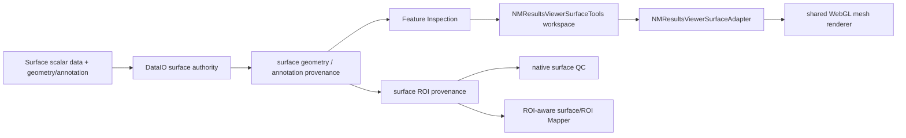

# Native surface architecture

## Scope

Native surface support spans DataIO provenance, geometry/annotation validation, Feature Inspection scientific selection and browser rendering. The central architectural requirement is that vertex/ROI values remain bound to their validated surface identity and vertex ordering.

## Data flow

## DataIO ownership

`dataio/NMDataIOSurfaceTools.m` owns surface-specific scientific validation and reading, including native geometry/annotation relationships. `dataio/NMDataIOImageImportTools.m` integrates this material into the modality import path and persists the resulting geometry/ROI provenance in the modality descriptor/import report.

`dataio/NMDataIOStateTools.m` and the DataIO browser preserve these fields across browser/API state and resume.

## Results Viewer ownership

`core/NMResultsViewerSurfaceTools.m` builds the native-surface workspace from the selected Feature Inspection material plus retained DataIO provenance. `ui/NMResultsViewerSurfaceAdapter.js` owns the browser representation, including native/inflated presentation choices and shared mesh-renderer interaction.

The Results Viewer does not use `NM.brainmask`, vertex-count guessing or generic feature labels as a replacement for persisted surface provenance.

## Surface ROI fields

Surface annotation collapse produces canonical ROI provenance through the common ROI boundary. ROI-valued surface data are therefore displayed on the surface using their annotation mapping rather than routed to the generic tabular QC/profile plot.

## Common rendering

Surface rendering shares the common mesh renderer and scene/program infrastructure with imaging surface projections and connectivity 3-D representations. See [COMMON_MESH_RENDERING_ARCHITECTURE.md](COMMON_MESH_RENDERING_ARCHITECTURE.md).
