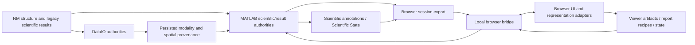

# NM2 system architecture

## Architectural scope

NM2 preserves the established NeuroMiner scientific computation and result containers while adding modular DataIO, browser-native configuration/viewing, and API/export pathways. The architecture is deliberately split so scientific materialization remains on the MATLAB side and browser code consumes explicit state/payload contracts rather than traversing `NM` directly.

## Layer model

## Authority boundaries

### Scientific and result materialization

MATLAB classes under `core/` own extraction and derivation of result payloads from `NM` and retained result structures. Browser code does not reconstruct legacy result-container grammar.

Principal anchors:

- `core/NMResultsViewerTools.m`
- `core/NMResultsViewerScientificAnnotation.m`
- `core/NMResultsViewerScientificCapability.m`
- `core/NMResultsViewerScientificState.m`
- `core/NMResultsViewerScientificDirectory.m`

### Data and spatial provenance

DataIO owns source-type normalization, import/probe state, modality descriptors, canonical ROI provenance, surface geometry provenance, connectivity node/edge provenance, and QC preparation.

Principal anchors:

- `dataio/NMDataIOStateTools.m`
- `dataio/NMDataIOImageImportTools.m`
- `dataio/NMDataIOROIProvenanceTools.m`
- `dataio/NMDataIOSurfaceTools.m`
- `dataio/NMDataIOConnectivityTools.m`

### Browser session boundary

`ui/NMResultsViewerUI.m` creates the read-only browser session and handles the restricted MATLAB-service operations needed by the browser. Browser modules receive JSON-safe state/payloads and call explicit services for material that is not already resident.

Principal anchors:

- `ui/NMResultsViewerUI.m`
- `ui/NMResultsViewerUI_main.js`
- `bridge/nm_open_ui.m`
- `bridge/nm_ui_bridge_dispatch_requests.m`
- `bridge/nm_ui_bridge_python_template.m`

### Representation and rendering

Representation-specific browser modules own presentation state and rendering. Shared rendering primitives are factored below them; scientific payload extraction remains above them.

Principal anchors:

- `ui/NMResultsViewerImagingViewer.js`
- `ui/NMResultsViewerSurfaceAdapter.js`
- `ui/NMResultsViewerConnectivity3D.js`
- `ui/NMWebGLMeshRenderer.js`
- `ui/NMResultsViewerOutput.js`

## Read/write direction

The Results Viewer is read-only with respect to modelling results. Browser interactions may update transient viewer state, request derived/read-only payloads, persist presentation state, generate report/export requests, and write export files through explicit backend services. They do not alter fitted models or silently reinterpret DataIO provenance.

## Documentation ownership

Cross-layer relationships such as the diagrams above belong here. Function-local contracts belong only in their implementing source functions.
